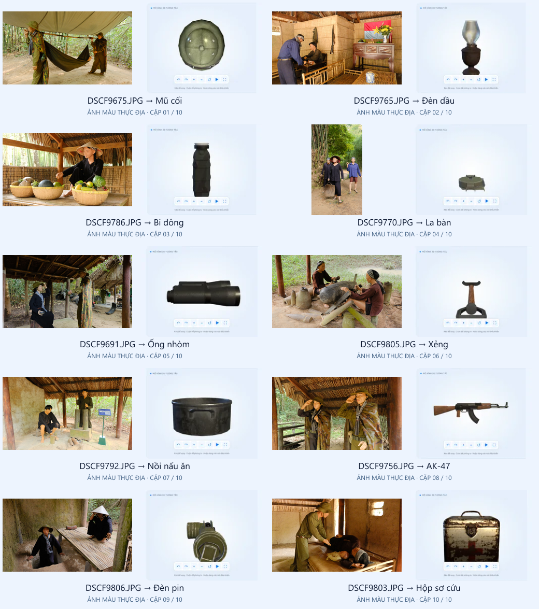

# 10 ảnh màu thực địa — 10 mô hình AR

Mỗi ảnh do nhóm cung cấp được ghép với đúng một mô hình, không dùng chung ảnh. Bản gốc trong `public/assets/ar-targets/originals/` giữ nguyên từng byte; SHA-256 đối chiếu khi nhập từ Downloads. Bản dùng trên web giữ màu, toàn bộ khung hình và áp dụng chiều xoay EXIF, chỉ giảm cạnh dài xuống 1600px để tải nhanh. Không cắt, đổi màu, chuyển đen trắng hoặc vẽ thêm lên ảnh.

| Ảnh gốc | Mô hình mở bằng ảnh | Chỉ mục | Bối cảnh ảnh |
|---|---|---:|---|
| DSCF9675.JPG | Mũ cối | 0 | Mô hình chiến sĩ bên võng tại khu di tích |
| DSCF9765.JPG | Đèn dầu | 1 | Không gian sinh hoạt được tái hiện trong nhà |
| DSCF9786.JPG | Bi đông | 2 | Cảnh chuẩn bị thực phẩm và tiếp tế |
| DSCF9770.JPG | La bàn | 3 | Cảnh người dân trên lối đi trong khu di tích |
| DSCF9691.JPG | Ống nhòm | 4 | Cảnh người dân và chiến sĩ tại khu tái hiện |
| DSCF9805.JPG | Xẻng | 5 | Cảnh lao động với công cụ thủ công |
| DSCF9792.JPG | Nồi nấu ăn | 6 | Khu tái hiện bếp Hoàng Cầm |
| DSCF9756.JPG | AK-47 | 7 | Mô hình chiến sĩ chào trong khu tái hiện |
| DSCF9806.JPG | Đèn pin | 8 | Cảnh người dân tại cửa hầm |
| DSCF9803.JPG | Hộp sơ cứu | 9 | Cảnh chăm sóc người bị thương |

## Trải nghiệm

1. Mở http://127.0.0.1:5175/ar-experience và chọn hiện vật.
2. Chọn **AR tại nhà**. Ảnh màu tương ứng và tên file gốc hiển thị trên thẻ. **Mở ảnh gốc** mở bản gốc không thay đổi. **Mở thẻ lớn / In thẻ** mở thẻ nhận diện; chọn in màu và giữ đầy đủ ảnh.
3. Giữ thẻ trên laptop hoặc in ra. Trên thiết bị có camera mở liên kết tương ứng qua QR, rồi bấm **Bật camera AR**. Localhost của laptop không truy cập trực tiếp từ điện thoại; dùng HTTPS hoặc Android USB forwarding theo hướng dẫn local của workspace.
4. Quét đúng ảnh của hiện vật đang chọn, giữ trọn khung và tránh phản sáng. Ảnh khác không mở mô hình đang chọn. Nhận diện ảnh không đồng nghĩa nhận diện trực tiếp người hoặc vật thể trong không gian thật.
5. Khi mô hình xuất hiện, thay đổi kích thước, xoay, bật chuyển động và đặt lại; tắt camera khi kết thúc.

Ảnh DSCF9770 có EXIF orientation 8, vì vậy bản web và dữ liệu biên dịch cùng dùng chiều dọc đúng. Các mô hình được ghép theo chủ đề để khám phá; không khẳng định từng mô hình 3D là bản số hóa vật thể cụ thể trong ảnh.

## Tái tạo

- `node scripts/prepare-ar-photos.mjs C:/Users/PC/Downloads`: nhập đúng 10 file và cập nhật metadata; sau bước này phải biên dịch lại trước khi phát hành.
- `node scripts/compile-ar-photos.mjs`: biên dịch offline trên localhost bằng bản MindAR 1.2.5 đã vendored. Không tải ảnh lên dịch vụ khác. Thứ tự catalog là thứ tự targetIndex; không đổi thứ tự riêng lẻ.
- `node scripts/audit-ar-photos.mjs`: ghi hash, kích thước, màu, orientation và số đặc trưng vào [ar-photos-audit.json](./ar-photos-audit.json).
- `npm run test:ar`: kiểm tra catalog/ảnh màu/hash, chỉ mục 0–9, UI/QR/in và 10 cặp nhận diện bằng camera giả lập.
- `npm run build`: bản production. Ảnh gốc chỉ tải khi người dùng mở liên kết; ảnh JPG và bundle nhận diện không nằm trong precache PWA.

Bộ nhận diện mới là `/assets/cu-chi-targets.mind`. Ảnh nhận diện đen trắng cũ không còn được catalog hoặc runtime sử dụng. MindAR có thể dùng cường độ sáng nội bộ để trích đặc trưng; điều này không thay đổi ảnh màu hiển thị cho người dùng. Kiểm tra giả lập cần được bổ sung bằng camera điện thoại thật với ánh sáng và góc nhìn thực tế.

## Kết quả kiểm tra — 20/10/2026

- 19 kiểm tra Node đạt: catalog, tính duy nhất, màu, hash bản gốc, dữ liệu biên dịch, runtime và khung nhìn.
- Bộ 21 kiểm tra trình duyệt đạt, gồm nhận diện/render/cleanup của đủ 10 cặp bằng camera giả lập và kiểm tra âm tính khi đưa ảnh khác cho mũ cối.
- Sau khi giới hạn chiều cao ảnh dọc khi in, 3 kiểm tra tập trung đạt lại: 10 thẻ màu/ảnh gốc, QR/in và thẻ dọc vừa chiều cao một trang A4.
- ESLint các file TypeScript/TSX thay đổi đạt. Localhost 5175 phục vụ catalog mới và bundle nhận diện HTTP 200.
- Chưa kiểm tra camera điện thoại thật.

Bản build production và PWA đã đạt. Đã đối chiếu source/public/dist: catalog, ảnh web, hash ảnh gốc và bundle nhận diện đồng bộ. Ảnh gốc đối chiếu trực tiếp với 10 file trong Downloads không thay đổi. Build vẫn có cảnh báo chunk JavaScript lớn như trước.
